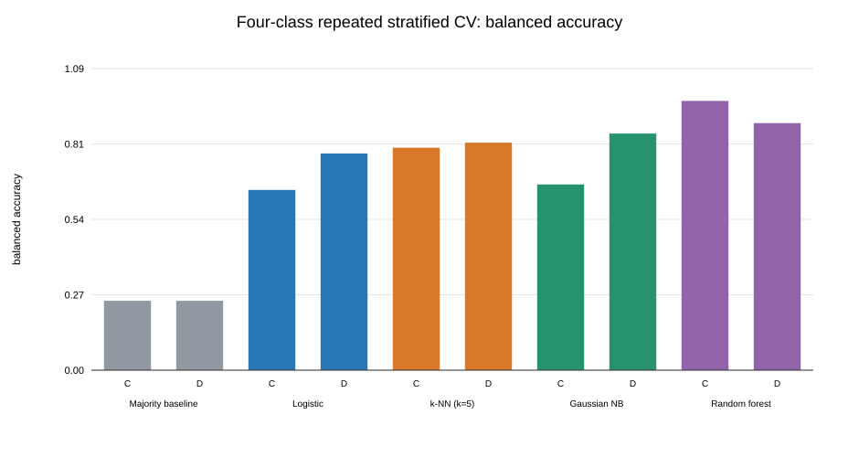
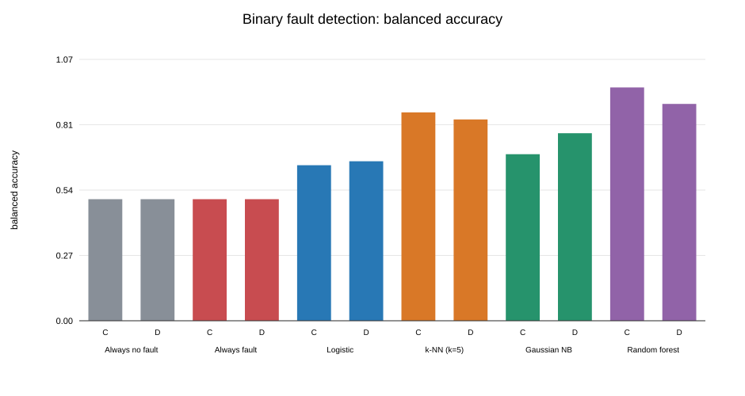

# Диагностика ультразвуковых расходомеров C и D

## Короткий вывод

Сравнение теперь включает несколько классификаторов и два простых ориентира. Для исходной задачи с четырьмя классами лучше всего сработал случайный лес при проверке внутри каждого счётчика. Но при переносе на другой прибор результаты резко ухудшились. Поэтому высокая точность внутри C или D ещё не означает, что модель готова диагностировать новый расходомер.

Дополнительно состояние сведено к простому вопросу: **есть ли неисправность?** Для него проверены базовые прогнозы «всегда исправен» и «всегда неисправен» и несколько моделей. Это отдельная бинарная оценка; она не заменяет четырёхклассовую постановку.

## Данные и сравниваемые модели

Использованы только приложенные данные счётчиков **C** и **D**: 181 и 180 записей. В каждой записи 43 диагностических признака и один класс: 1 — исправен, 2 — газ в потоке, 3 — влияние установки, 4 — отложения парафина/воска. Состав и порядок признаков описаны в [описании данных](data/README.md).

Для четырёх классов сравнивались:

- прогноз самым частым классом обучающей части;
- логистическая регрессия;
- k ближайших соседей (k-NN, k=5);
- Gaussian Naive Bayes;
- случайный лес (25 деревьев, глубина до 6).

В бинарной оценке класс 1 означает «нет неисправности», а классы 2–4 объединены в «есть неисправность». В дополнение к тем же моделям проверялись два постоянных прогноза: «всегда нет неисправности» и «всегда есть неисправность».

Качество проверялось 5-кратной стратифицированной кросс-валидацией с 5 повторами отдельно для C и D. Таблицы показывают средние результаты по 25 проверочным складкам. Затем каждая модель обучалась на одном приборе и проверялась на другом. Масштабирование k-NN и логистической регрессии выполнялось только по обучающей части.

## Четыре класса: результаты внутри прибора

| Модель | C: balanced accuracy | C: macro-F1 | D: balanced accuracy | D: macro-F1 |
|---|---:|---:|---:|---:|
| Большинство классов | 0,250 | 0,115 | 0,250 | 0,117 |
| Логистическая регрессия | 0,649 ± 0,074 | 0,660 | 0,781 ± 0,080 | 0,796 |
| k-NN | 0,801 ± 0,074 | 0,811 | 0,819 ± 0,059 | 0,833 |
| Gaussian Naive Bayes | 0,669 ± 0,061 | 0,659 | 0,852 ± 0,058 | 0,862 |
| **Случайный лес** | **0,970 ± 0,028** | **0,972** | **0,890 ± 0,060** | **0,895** |

Случайный лес оказался сильнейшим вариантом внутри C и D. Его средняя полнота по классам также высока: для C она составляет 0,974 / 0,958 / 0,952 / 0,996 для классов 1–4; для D — 0,787 / 0,908 / 0,865 / 1,000. Это оценки при перемешивании записей одного и того же прибора, а не проверка на новом приборе.

## Бинарный вопрос: есть ли неисправность?

| Модель | C: balanced accuracy | C: F1 неисправности | D: balanced accuracy | D: F1 неисправности |
|---|---:|---:|---:|---:|
| Всегда «нет неисправности» | 0,500 | 0,000 | 0,500 | 0,000 |
| Всегда «есть неисправность» | 0,500 | 0,825 | 0,500 | 0,835 |
| Логистическая регрессия | 0,640 | 0,859 | 0,656 | 0,872 |
| k-NN | 0,857 | 0,929 | 0,828 | 0,908 |
| Gaussian Naive Bayes | 0,685 | 0,537 | 0,771 | 0,702 |
| **Случайный лес** | **0,960** | **0,978** | **0,892** | **0,945** |

Постоянный прогноз «всегда неисправность» получает высокую обычную accuracy — около 70% — потому что неисправных записей больше. Но он не распознаёт ни одного исправного счётчика: специфичность равна нулю. Прогноз «всегда исправен» даёт обратную ошибку и F1 неисправности 0. Поэтому для сравнения важны balanced accuracy, precision/recall и F1, а одной accuracy недостаточно.

## Перенос между C и D

| Модель | 4 класса C→D | 4 класса D→C | «Неисправность» C→D | «Неисправность» D→C |
|---|---:|---:|---:|---:|
| Логистическая регрессия | 0,260 | **0,402** | 0,500 | 0,535 |
| k-NN | 0,259 | 0,250 | 0,500 | 0,500 |
| Gaussian Naive Bayes | 0,255 | 0,250 | 0,500 | 0,500 |
| Случайный лес | **0,293** | 0,201 | **0,844** | 0,500 |

Для четырёх классов перенос близок к случайному уровню 0,25, хотя внутри прибора случайный лес показывал 0,89–0,97. В бинарной проверке лес переносится из C в D лучше остальных, но в обратном направлении снова предсказывает почти только «неисправность» и получает balanced accuracy 0,50. Это сильная зависимость результата от конкретного прибора.

Сравнение также видно на [нормированных матрицах ошибок логистической модели](figures/cross_meter_confusion.svg). Подробные метрики, включая показатели постоянных прогнозов, сохранены в файлах model_comparison_summary.csv и model_transfer.csv в папке results.

## Признаки и ограничения вывода

Для дополнительной интерпретации выполнена групповая перестановка признаков в логистической модели. Наибольший средний вклад дают качество сигнала (падение balanced accuracy на 0,120), усиление (0,112), мощность сигнала (0,077) и время пролёта (0,044). Профиль-фактор, симметрия и поперечный поток дают небольшой добавочный вклад. Это полезность для конкретной модели, а не доказательство физической причинности; признаки разных акустических путей коррелируют.

Итог: несколько моделей и бинарные базовые прогнозы теперь позволяют оценить, насколько результаты превосходят простые ответы. Внутренняя CV показывает, что состояния в данных распознаваемы, но кросс-приборный тест выявляет сильный сдвиг. Для практической диагностики нужны измерения с большего числа приборов и независимая проверка на новых экземплярах.
